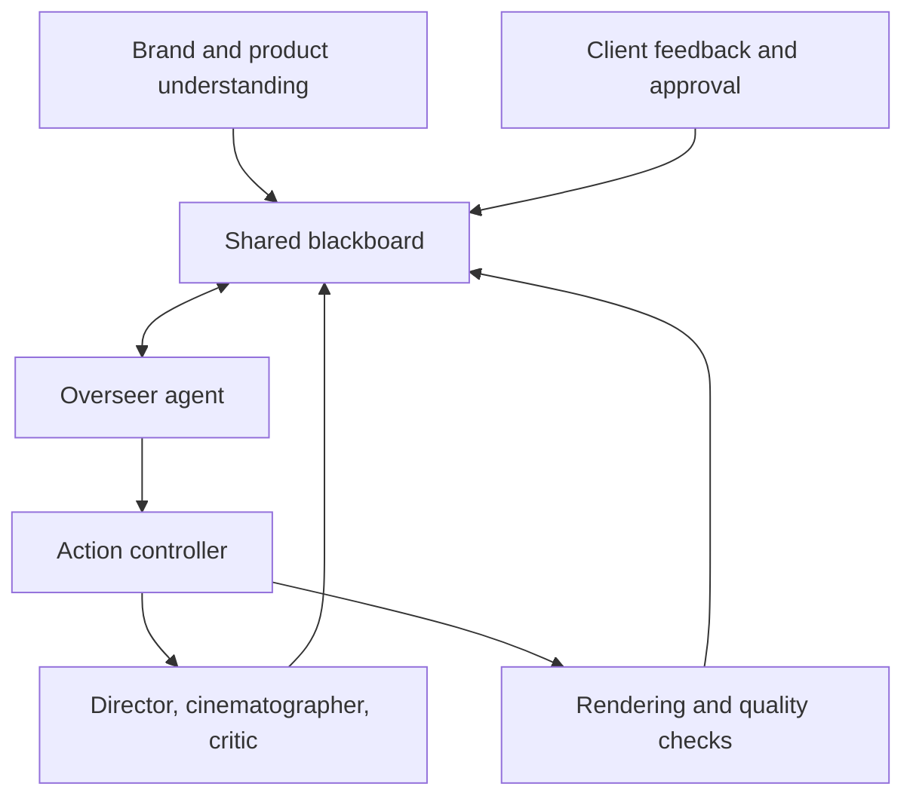

# Corvo Multi-Agent Runtime

A multi-agent system for brand-specific creative commercial production, featuring a shared "blackboard", specialist agents, human feedback, and quality control. Result is a production of a commercial level of ad video.

Corvo's FilmRoom is a collaborative agent system for developing brand-specific video campaigns. It combines a shared, persistent blackboard with specialized AI roles, explicit critiques, controller-enforced actions, and client approval.

This repository contains the **actual backend implementation** extracted from Corvo source snapshots retained on July 21, 2026. It is a source release, not a verified copy of the current production deployment. The user-facing app is intentionally excluded.

## Architecture



- **Understanding and strategy:** build the working brief from brand and product inputs.
- **Overseer:** reasons over the current state and proposes the next actions.
- **Director:** develops and revises the creative direction and script.
- **Cinematographer:** turns direction into shot and storyboard plans.
- **Critic:** raises, revisits, and resolves objections about the creative and its execution.
- **Blackboard and controller:** store state and events, dispatch actions, apply budgets, and record progress and failures. Delivery requires an overseer proposal and client approval; rendering and assembly have additional checks.

The roles are distinct LLM-driven agents, but they do not require different underlying models. Per-role model IDs can be configured; the archived defaults use the same model for multiple roles. Their outputs are not a guarantee of creative quality, safety, or factual accuracy.

## What's included

| Path | Purpose |
| --- | --- |
| `agent-runtime/room/` | Active blackboard controller, role implementations, storyboard, rendering, and QC adapters. |
| `agent-runtime/understanding/`, `strategy/` | Brand/product understanding, strategy, and the AI/database/tool proxy interface. |
| `supabase/functions/` | Selected edge functions supporting the runtime, FilmRoom, product memory, generation, and credit flows, plus shared code. |
| `vps-assembler/` | Separate FFmpeg-based video assembly service. |
| `reference/supabase/migrations/` | Historical schema migrations supplied as reference only. One user-specific historical data fix was deliberately omitted. |
| `tests/` | Offline tests for blackboard authority and a stubbed controller dispatch flow. |

`/films` uses the blackboard architecture. The older `/room/deliberate` endpoint is retired; its legacy modules are present as historical source, not the active path.

## Try the offline tests

With Node.js installed, run from the repository root:

```sh
node --test tests/*.test.js
```

The tests use local temporary storage and deterministic stubs. They do not call model APIs, Supabase, or paid rendering services. They do **not** establish that the external integrations or end-to-end production workflow work.

## Running the service

The runtime is an integration-dependent source snapshot, not a one-command demo. A real deployment requires a separate Supabase project with compatible schema and functions, configured identity and shared secrets, appropriate provider credentials, persistent storage, and video/image infrastructure. It may incur model and rendering charges.

1. Review the code and integrations for your own environment. Do not run historical migrations against an existing database without reviewing them individually.
2. Install `agent-runtime/` dependencies using the accompanying package manifest and lockfile, subject to your environment's dependency and licensing review.
3. Copy `.env.example` to a private environment file for `agent-runtime/` and provide only your own values. Set `BB_DIR` to a writable persistent directory. Configure per-role models supported by your provider.
4. Configure and deploy the relevant Supabase functions to an isolated project, and set `VPS_PROXY_URL`, `VPS_SHARED_SECRET`, and `AGENT_URL` appropriately. This preview does not include a tested setup procedure for a fresh Supabase instance.
5. Start the runtime from `agent-runtime/` with `npm start`. `GET /health` is a basic process check; protected routes fail closed when `VPS_SHARED_SECRET` is absent.

Image, video, BGM, billing, and assembly integrations require additional configuration; see `.env.example` and the source. The optional face-detection model referenced by `room/eyemask.py` is not bundled in this preview; obtain any such model separately only after verifying its license and suitability. Legacy code may contain additional environment-specific assumptions. Never connect this preview to production services without an independent review.

## Release status

The source is assembled from a VPS runtime snapshot and a separate candidate frontend/backend snapshot. They have not been checked against the latest live Corvo system or validated together end to end. Runtime data, customer sessions, credentials, UI, and the generated test artifacts are excluded. Known hard-coded Corvo production endpoints were replaced by environment variables in this preview. Automated scans and offline tests are limited, and the full code, historical migrations, third-party materials, and dependency licenses still require review before publication.

The proxy allowlist references an `infer-anti-identity` function which was not present in the candidate snapshot. That optional call requires a separate compatible implementation. The historical migrations are incomplete by design and have not been tested as a clean database installation.

The project is released under the MIT license in `LICENSE`. Third-party dependencies and optional assets remain subject to their own terms.
